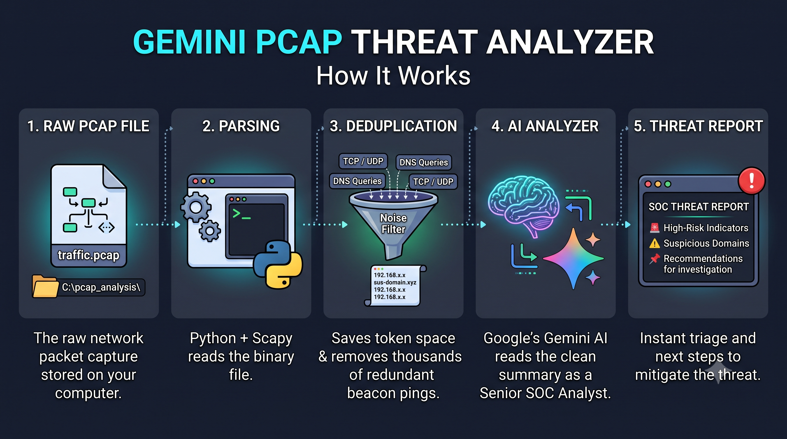

# AI-Powered PCAP Threat Analyzer (Gemini)

The AI-Powered PCAP Threat Analyzer is a lightweight, Python-based automation tool designed for Security Operations Center (SOC) analysts and Incident Responders. Analyzing raw network packet captures (PCAP) manually in Wireshark is incredibly time-consuming and prone to human error. Furthermore, raw binary PCAPs cannot be fed directly into Large Language Models due to extreme token-limit constraints and binary encoding.

This script acts as a highly efficient translation and triage layer. It leverages the scapy library to digest PCAP files, extracts high-signal network metadata (unique TCP/UDP connections and DNS queries), and formats this data into a lightweight summary. This summary is then transmitted to Google's Gemini LLM via the google-genai SDK. Instructed by a strict, role-based prompt, Gemini analyzes the traffic for Command and Control (C2) beaconing, Domain Generation Algorithms (DGA), phishing links, and data exfiltration attempts, returning a structured, actionable threat intelligence report.

# AI-Powered PCAP Threat Analyzer (Gemini)

As a SOC Analyst, time to triage (TTT) is your most critical metric. This repository provides several distinct advantages for rapid incident response:

**-Token & Resource Efficiency:** Bypasses LLM token limits by stripping out raw payload noise. By using Python set() structures, it deduplicates thousands of packets into a concise list of unique connection flows and DNS queries, drastically reducing the payload sent to the API.

**-Zero-Day & Anomaly Detection:** Unlike traditional IDS/IPS systems (like Snort or Suricata) that rely strictly on known signatures, Gemini utilizes heuristic reasoning to identify highly entropic domains (DGAs), suspicious port mismatches, and unusual beaconing behavior that standard tools might miss.

**-Reduced Alert Fatigue:** Automates the initial, tedious phase of PCAP analysis. Instead of manually filtering through Wireshark noise, the analyst immediately receives a synthesized report highlighting only the high-risk indicators.

**-Low Hallucination Rate:** The script strictly enforces a low model temperature (0.1) during the Gemini API call, ensuring the AI relies strictly on the provided network telemetry rather than generating speculative or hallucinated data.

# How it Works

1) **Packet Ingestion:** The script loads the target .pcap file from a local directory using Scapy. rdpcap() dedicated packet parsing library in Scapy to read scrambled, unreadable characters as PCAPs are compiled binary files

2) **Metadata Extraction & Deduplication:** It iterates through every packet, checking protocol layers.
	- If the packet contains IP and TCP/UDP layers, it extracts the Source IP, Source Port, Destination IP, and Destination Port.
	- If the packet contains a DNS Question Record (DNSQR), it extracts and decodes the requested domain name.
	- Data is stored in Python sets to automatically deduplicate redundant heartbeat/beaconing traffic.

3) **Telemetry Summarization:** The script truncates the extracted data to ensure the data safely fits within the LLM's context window and formats it into a clean, readable text string.

4) **AI Threat Analysis (Gemini API):** The formatted network telemetry is combined with a rigorous System Prompt instructing the model to impersonate as an Expert SOC Analyst. The request is sent securely to the Gemini API (gemini-3.8-flash).

5) **Structured Reporting:** Gemini evaluates the traffic for anomalies and outputs a structured triage report directly to the terminal, detailing:
	- High-Risk Indicators (e.g., non-standard protocols on standard ports).
	- Suspicious Domains & IPs.
	- Specific recommendations for further SOC investigation (e.g., host isolation, running AV scans).

